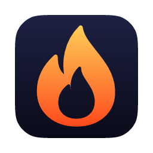

# Forge



A strength-training tracker for iPhone and Mac, with a JSON command line and an MCP server so an AI assistant can read and change the same data as the apps, safely and undoably. Built as a self-hosted replacement for Hevy.

## What it does

- **Log workouts on iPhone**: start from a routine, see what you lifted last time, tick off sets, and get a rest timer with a lock-screen Live Activity and a bell that rings even with the phone locked. An in-progress workout is saved to disk as you type, so it survives the app being killed.
- **Review and plan on Mac**: a dashboard (this week at a glance, training calendar, recent records, sleep against training), per-exercise progress charts, and routines laid out whole and edited in place with drag-to-reorder.
- **Progress stats**: estimated one-rep max (Epley), personal records recomputed from history, weekly working sets per muscle, and a forgiving exercise search that tolerates typos and abbreviations ("bnch", "extention").
- **Every change is an undoable op**: all writes go through a log of typed operations with stored inverses. Undo is per author and refuses, rather than forces, when someone else has since edited the same thing.
- **AI-safe agent interface**: the `forge` CLI and the MCP server expose everything the apps can do, including bulk edits with a preview step and read-only SQL. Deleting an exercise with history requires an explicit merge or force, so nothing is silently wiped.
- **Sync and integrations**: phone, Mac and a server copy stay in step through a small self-hosted hub. Imports exercises, routines and workouts from Hevy (API or exported JSON), writes finished workouts to Apple Health and reads sleep, HRV and resting heart rate back.

## How it works

```
  iPhone app ─┐                                     ┌─ Mac app
  (SwiftUI,   │        ForgeUI (shared SwiftUI)     │  (SwiftUI)
   widget)    └──────────────┬──────────────────────┘
                             │
                ForgeCore: model, op log, undo, stats, sync      forge CLI ── forge_mcp.py ── AI assistant
                             │                                       │
                     SQLite (GRDB)  ◄────────────────────────────────┘
                             │
                     forge sync / sync-serve  ◄──►  hub (a Forge database behind HTTP)
```

- **`ForgeCore`** (Swift package) owns the data: the SQLite schema (via GRDB), whole-aggregate reads and writes, the `Op` enum every change is expressed in, the change log with inverses for undo, stats, Hevy import, recovery data and both sides of sync.
- **`ForgeUI`** (Swift package) holds the app model, the live workout session, the rest timer, the Apple Health bridge and every SwiftUI screen, shared by both apps.
- **`App/`** is an XcodeGen project with three targets: the iOS app, its rest-timer Live Activity widget extension, and the macOS app.
- **`forge`** (Swift CLI, swift-argument-parser) is a JSON-in, JSON-out command line over `ForgeCore`. Changes are tagged with an author (`claude` by default), and `forge sync-serve` runs the sync hub.
- **`mcp/forge_mcp.py`** is a dependency-free stdio MCP server that wraps the CLI one tool per command (26 tools), so the assistant and the command line behave identically. It syncs before each call and after each write.
- **Sync** is last-writer-wins per entity with a logical clock: each device pushes its ops to the hub, the hub numbers them in one global order, and every device applies them with the same rule, so all copies converge with nothing to resolve by hand. See [docs/hub.md](docs/hub.md).

## Tech stack

Swift 6, SwiftUI, GRDB (SQLite), swift-argument-parser, ActivityKit / WidgetKit, HealthKit, XcodeGen, Swift Testing; Python 3 (standard library only) for the MCP server.

## Getting started

Requirements: macOS 15+, Xcode 16+ (Swift 6 toolchain), [XcodeGen](https://github.com/yonaskolb/XcodeGen) for the apps (`brew install xcodegen`), Python 3 for the MCP server. The apps target macOS 15 and iOS 18.

```bash
cp .env.example .env            # set DEVELOPMENT_TEAM for iOS device builds
```

**Mac app**

```bash
scripts/build-mac.sh Release    # generates the Xcode project, builds App/build.noindex/.../Forge.app
```

**iPhone app**: run `scripts/generate-project.sh`, open `App/Forge.xcodeproj` and run the `ForgeiOS` scheme. Apple Health needs a signed build with the HealthKit entitlement, so it works on a device or a signed simulator build.

**CLI**

```bash
swift build --package-path CLI -c release       # CLI/.build/release/forge
mkdir -p ~/.local/bin && ln -sf "$PWD/CLI/.build/release/forge" ~/.local/bin/forge
```

**MCP server** (for Claude Code; any MCP client that runs stdio servers works):

```bash
claude mcp add forge -- python3 /path/to/forge/mcp/forge_mcp.py
```

**Sync hub**: see [docs/hub.md](docs/hub.md) for tokens, running `forge sync-serve`, and a launchd template in `scripts/`.

### Configuration

The database defaults to `~/Library/Application Support/Forge/forge.sqlite`, the file the Mac app opens.

| Variable | Used by | Purpose |
| --- | --- | --- |
| `DEVELOPMENT_TEAM` | `scripts/generate-project.sh` (from `.env`) | Apple Developer team ID for iOS signing |
| `FORGE_DB` | CLI, MCP server, Mac app | Database path override (the CLI also takes `--db`) |
| `HEVY_API_KEY` | `forge import-hevy` | Hevy API key (or use `--from-dir` with exported JSON) |
| `FORGE_BIN` | MCP server | Path to the `forge` binary |
| `FORGE_AUTOSYNC` | MCP server | `0` turns off syncing around tool calls |

## The command line

Everything prints JSON; errors are `{"error": "..."}` on stderr with exit code 1. A database created by the CLI starts with no exercises: the apps offer a one-tap starter library, `forge exercise put` adds one, and `forge import-hevy` brings a full library. Routines and workouts refer to exercises by name or id.

```bash
forge import-hevy                                   # HEVY_API_KEY, or --from-dir with templates/routines/workouts JSON
forge exercise list --match acme
forge routine remove-exercise Acme --preview        # see the effect first
forge routine remove-exercise Acme                  # one undoable change
forge exercise delete <id> --merge-into <other id>  # history moves; --force removes it everywhere
forge routine put --json '{"title":"Push","exercises":[{"exercise":"Bench Press (Barbell)","sets":[{"weightLb":135,"reps":8}]}]}'
forge stats prs <exercise id>
forge sql "select name, count(*) from exercises group by 1"   # read-only; `forge schema` lists the tables
forge undo                                          # reverses the latest change by --author
forge export --out backup.json                      # everything as one readable JSON document
forge sync-setup --url https://… --token …  &&  forge sync
```

## Tests

```bash
swift test --package-path Core                  # 112 tests
swift test --package-path UI                    # 125 tests
swift test --package-path CLI                   # 20 tests
swift build --package-path CLI -c release && python3 -m unittest discover -s mcp   # 12 tests, uses the release CLI
```

About 270 tests in all. Core covers the op log and undo, routine edits and exercise merges, stats, Hevy import, recovery, export, the read-only SQL guard, loading a thousand workouts quickly, and sync convergence (concurrent edits, deletes against edits, two connections to one file). UI covers the workout session, rest timer and units, search ranking, dashboard numbers, the history calendar, a rendered dashboard snapshot, and performance budgets for reloading the app model and typing into a live workout. CLI and MCP tests run the real commands and a real hub end to end against temporary databases.

## Project layout

```
Core/        ForgeCore: model, schema, ops and undo, stats, Hevy import, sync (client and hub)
UI/          ForgeUI: app model, workout session, rest timer, HealthKit bridge, SwiftUI views
App/         XcodeGen project.yml, iOS app, Live Activity widget, macOS app, asset catalogs
CLI/         forge command line, including the sync hub server
mcp/         stdio MCP server wrapping the CLI, with tests
docs/        hub.md: running the sync hub
scripts/     project generation, Mac build, hub launchd template, rest-bell synthesizer
tools/       app icon sources and the script that renders them into the asset catalogs
CLAUDE.md    notes for AI coding assistants working in this repo
```

## License

See [LICENSE](LICENSE).
